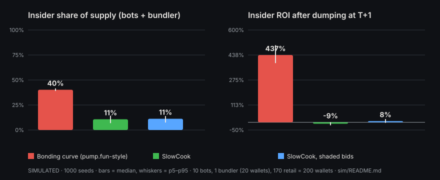

# SlowCook: memecoin launches where being first is worthless

[](https://github.com/professor-12/slowcook/actions/workflows/ci.yml)

**Live demo:** https://web-omega-dun-65.vercel.app · **Testnet contract:** `slowcook-674040.testnet` (deployed 2026-11-14 with the creator-lock fix)

SlowCook is a memecoin launchpad on NEAR:
- **Sealed bids** go into a **single clearing price** that everyone pays.
- **Unsold supply burns.**
- Trading opens **at exactly that price**.
- A rule-bound **Floor Keeper** treasury defends the price.
- The creator's allocation is **locked for at least 7 days**, then **vests linearly over at least 7 more**, and is released only while the price holds **above clearing + 5%**.

Tracks: **Memecoins** (primary) and **DeFi**. Network: **NEAR testnet** (test NEAR, no real value).

> **For automated reviewers:** every claim below has a command that reproduces it. Simulated numbers are labelled **SIMULATED**. Testnet transactions are labelled **REAL** and link to the explorer.

---

## The problem

On bonding-curve launchpads (pump.fun and clones), every buy raises the price, so **the first buyer pays the least**:
- **More than 50%** of pump.fun tokens are sniped in the same block they are created, and deployer-funded same-block snipers were profitable 87% of the time (Pine Analytics, 2025-04-21).
- Coordinated (bundled) accounts hold **36.5%** of supply on average across 41k+ Solana launchpad launches (MELT dataset, arXiv 2602.13480, 2026).
- **98.6%** of 7M+ pump.fun tokens fell below $1,000 of liquidity (Solidus Labs, 2025 Rug Pull Report). That is their definition, not "98.6% are frauds".

Sources and caveats: [`research/00-brief.md`](research/00-brief.md).

## How it works

```
 create_launch ─▶ COMMIT (hash only) ─▶ REVEAL (contract checks hash) ─▶ finalize ─▶ TRADING
                                                                          │
              one clearing price for all winners ◀───────────────────────┤
              unsold supply never minted (burned) ◀───────────────────────┤
              pool seeded at exactly the clearing price ◀─────────────────┤
              treasury = rest of proceeds ─▶ Floor Keeper (poke → TWAP → defend → burn)
              creator allocation ─▶ locked ≥ 7 days ─▶ vests linearly ≥ 7 days, released only
                                    while h interval TWAPs (≥ 7 days) stay ≥ clearing × 1.05
```

1. **Create.** The creator sets name, ticker, supply, split (sale/LP/creator, creator ≤ 10%), minimum price, the commit/reveal windows and the Floor Keeper parameters. A NEP-141 token is deployed at `<ticker>-<id>.<factory>` with **zero supply**.
2. **Seal.** Each bidder sends `sha256("<launch>:<bidder>:<tick>:<qty>:<salt>")` plus a deposit. Only the hash is on-chain. Depositing more than the bid costs hides the real bid.
3. **Reveal.** The contract recomputes the hash (`E_HASH` on mismatch) and checks `deposit ≥ price × qty`.
4. **Clear.**
   - `finalize` walks 64 price ticks from high to low until demand covers the sale supply. That tick's price is **the price everyone pays**.
   - Bids at the marginal tick are filled pro rata.
   - If demand is short, the price is the minimum and the unsold supply is **never minted** (burned).
5. **Claim.** Winners get tokens plus `deposit − clearing × filled` back. Losers get everything back. Unrevealed bids lose a 5% penalty, which goes to the treasury.
6. **After launch.**
   - Part of the proceeds and the LP tokens seed a constant-product pool at the clearing price; that liquidity is locked.
   - The rest funds the **Floor Keeper**. If the *time-weighted* price stays below `clearing − 10%` for k observations, anyone can call `defend()`. It buys tokens back with at most 10% of the treasury per epoch, never pushes the price above clearing, and burns what it buys.
   - **Creator lock.** Nothing moves before `finalized_at + creator_lock` (at least 7 days). After that the allocation vests linearly over `creator_vest` (at least 7 days), and `unlock_creator` sends only the newly vested part, and only if the last h interval TWAPs were all at or above **clearing × 1.05**. The pool opens exactly at clearing, so an untraded pool never counts as holding. h × poke interval must cover at least 7 days.

### Launch parameters: defaults and protocol minimums

The creator can raise any of these, never lower them below the minimum. `get_config` returns the same table from the contract.

| Parameter | Default | Protocol minimum | What the minimum protects |
|---|---|---|---|
| `creator_lock_secs` | 604,800 (7 days) | 604,800 (7 days) | No creator token moves before `finalized_at + lock` |
| `creator_vest_secs` | 2,592,000 (30 days) | 604,800 (7 days) | The allocation cannot leave in one transfer |
| `h_obs` × `poke_interval_secs` (price hold) | 1,008 × 600 s = 7 days | 7 days | A short pump cannot satisfy the hold |
| Hold threshold | clearing × 1.05 | fixed | Readings must be **above** the opening price |
| `poke_interval_secs` | 600 | 60 | One TWAP interval cannot be a single block |
| `k_obs` (and `k_obs` × poke) | 6 (1 hour) | 3 (30 minutes) | A brief dip cannot trigger a buyback |
| `epoch_secs` | 86,400 (1 day) | 3,600 | The `r_bps` cap cannot be reset every few seconds |
| `r_bps` | 1,000 (10%) | 1 to 5,000 | Treasury spend per epoch |
| `band_bps` | 1,000 (floor = clearing − 10%) | 100 to 5,000 | |

**Demo timings (testnet only).** A factory initialised with `demo: true` can accept launches with `demo: true` and short timings: lock ≥ 30 s, vest ≥ 10 s, poke ≥ 1 s, epoch ≥ 10 s. The contract refuses `demo: true` at init unless the factory account ends in `.testnet`. Every view returns `params.demo`, and the launch page shows a **Demo timings** badge with the actual lock, vest and poke values. The testnet demos below use demo timings so they finish in minutes.

### Security fix: creator-lock bypass (2026-11-14)

A code review found that the creator lock could be bypassed.
- **Bug.** `unlock_creator` only needed `h_obs` consecutive interval TWAPs **at or above** clearing. The pool opens **exactly at** clearing, so an untraded pool counted as holding. With no time lock and no minimum on `h_obs` or the poke interval, a creator could set `h_obs = 1`, poke after 1 s, and take the whole allocation about a second after finalize.
- **Fix.** The rules in the table above: a 7-day minimum lock from finalize, readings at or above clearing × 1.05, a hold of at least 7 days, a linear vest of at least 7 days, and minimums on `k_obs`, epoch and poke interval. Demo timings exist only on a `.testnet` factory and are labelled per launch.
- **Tests first.** `contracts/slowcook/src/creator_lock_tests.rs` was committed before the fix. On the old rules 9 of its unit tests and its property test failed; the property test's minimal case paid the creator 5 hours after finalize with a 0-day lock ([`verification/creator-lock-red.txt`](verification/creator-lock-red.txt)). They all pass on the fix.
- **Affected deployments.** Launches 0 and 1 on the first factory, `slowcook-0dd752.testnet`, ran the old rule (their creator was our own demo account). The fixed contract runs on a fresh factory, `slowcook-674040.testnet`. The auction, pool and buyback code did not change; the only auction change is recording `finalized_ms`.

Mechanism details and every deviation from the original brief: [`research/03-design-decisions.md`](research/03-design-decisions.md). Contract internals: [`docs/ARCHITECTURE.md`](docs/ARCHITECTURE.md).

## Evidence

### SIMULATED: the same 200 wallets through a bonding curve and through SlowCook (1000 seeds)

The 200 wallets are 10 sniper bots, 1 bundler with 20 wallets, and 170 retail buyers. In SlowCook the insiders get the *strongest* strategy we could build: perfect knowledge of retail demand, bidding one tick above the clearing price.

| median (p5–p95) | Bonding curve | SlowCook |
|---|---|---|
| Insider (bots + bundler) share of supply | **40.3%** (39.0–41.6) | **10.7%** (6.9–14.3) |
| Insider ROI after dumping at T+1 | **+437%** (385–501) | **−9.2%** (−19.3 to −0.1) |
| Price retail paid ÷ price insiders paid | **4.26×** | **1.00×** |
| Median retail ROI after the dump | **−57.6%** | **−8.3%** |
| Price drop caused by the dump | 81.0% | 17.8% |



Reproduce with `pnpm sim` (about 3 s). Method, assumptions and what the sim does *not* show: [`sim/README.md`](sim/README.md).

Honest reading:
- When insiders dump, holders are still down, just far less.
- If retail shade their bids, insiders can exit at a small profit (median +7.6%, against +437% on the curve).

### REAL: NEAR testnet

Factory: **`slowcook-674040.testnet`**, deployed 2026-11-14 with the creator-lock fix. Its on-chain code hash `ALMDgepz9QLetuxSEcRC5C1QxepEtPrGbZUWSRQYiLWW` equals this repo's build (`target/near/slowcook/slowcook.wasm`, RPC `view_account`). `get_config` on it returns the minimums in the table above and `demo_allowed: true`.

#### Launch 0: deep pool, fixed contract (`deep-0.slowcook-674040.testnet`, 2026-11-14)

12 wallets with 1.3 NEAR of buying power each. **Demo timings**, labelled on the launch page: 15-minute creator lock, 3-minute vest, 10 s pokes, hold of 6 intervals.

**Prediction.** Before anything was sent, the TS model (the parity-tested mirror of the contract math) predicted the clearing price, tokens sold and pool depth. **The on-chain result matched all three exactly**: `onchain_matches_prediction` in the log.

| Step | Result | Tx |
|---|---|---|
| 12 wallets commit sealed bids | Only hashes and deposits are on-chain; the bid view shows `tick=null qty=null` | [create_launch](https://testnet.nearblocks.io/txns/DtVKSgpgSALUQJCg64mWAXRq9EtBk5vUufF8WfEn8g5o) · [a commit](https://testnet.nearblocks.io/txns/2wLspUMft8hBzqhHQUERzMzny5duWXxy6hzc8F6yZTX2) |
| Reveal with a wrong salt | Rejected `E_HASH` | [tx](https://testnet.nearblocks.io/txns/AkesCVnE4yYs47fiqbsT6RdzLZvcoee3gouHU2pzPZJ6) |
| `finalize` | **One clearing price: 1.953e-5 NEAR/token** (tick 6). All 600,000 sale tokens sold, 0 burned. **The pool opens at exactly that price with 5.858 NEAR + 300,000 tokens.** Treasury 5.93 NEAR | [tx](https://testnet.nearblocks.io/txns/9rRsEJcQNgcas1VndVUGNoVtXcg8GvEKdjLiPWj4g2fr) |
| The "sniper" (bid ~7× above clearing) claims | Paid exactly clearing × 9,409 = 0.1837 NEAR, **the same price per token as everyone**; the rest of the deposit refunded | [tx](https://testnet.nearblocks.io/txns/EevwMKM6sBDUngKQD6YcGJTMpKBg18xWDnP7JDVGe1GT) |
| Unrevealed bid | 0.0715 NEAR (5%) penalty → treasury | [tx](https://testnet.nearblocks.io/txns/2Ns2NBoQ4ud26SoYqLSsxEgzTPr1oYMhtbHJAgUMd78j) |
| Creator unlock right after launch | `E_LOCKED` | [tx](https://testnet.nearblocks.io/txns/DsW44QYxDBmU49cXkxXCvSRBrNTuytW1SQsiP7dZzkKk) |
| 6 holders dump 308,480 tokens: spot falls to 24% of clearing. Then `defend` before the trigger | `E_TRIGGER` | [tx](https://testnet.nearblocks.io/txns/C86aaWDetFEoA5GPWQoW58rMSCA1Pc3VQF8zA8sttkur) |
| 3 TWAP intervals below the floor → `defend` | Spent **0.5929 NEAR = exactly the 10% epoch cap**. Bought and **burned 103,215 tokens**; supply 1,000,000 → 896,784 | [tx](https://testnet.nearblocks.io/txns/E29i7jvS7YGLW4twXPEPjrtgUEU6zKq1BisE4YhTfZas) |
| `defend` again in the same epoch | `E_EPOCH_CAP` | [tx](https://testnet.nearblocks.io/txns/3oirdDs8iuzHddc3PEdGzq46uv1ugZFaBJC2m8BhCCsc) |
| A 2.83 NEAR buy lifts spot to 1.16× clearing. The first interval TWAP (1.79e-5, it includes pre-buy time) is below the 2.05e-5 hold price and does not count; the next 6 do | Hold met: 6 of 6 intervals | [buy](https://testnet.nearblocks.io/txns/GTE2FKGxGc3jb2Jj8Et19Rp7eRmJeYvrnrmYdWdJ5NVQ) |
| **(a)** `unlock_creator` with the price held but the lock running | **`E_LOCKED: creator lock ends at 1794621922793 ms (525 s left)`** | [tx](https://testnet.nearblocks.io/txns/DARXW1JeJ7uPo83DAPiJ4VQVP5gb3VPVvAvxABQXzmKg) |
| **(b)** `unlock_creator` part-way through the 3-minute vest | **61,937** of 100,000 tokens: only what had vested | [tx](https://testnet.nearblocks.io/txns/4sPCkd6jZGjuvfoKHCLJsurpM9RZzsoYvk55kpAccEky) |
| `unlock_creator` after the vest | The other **38,063**. Creator balance = 100,000 = the allocation | [tx](https://testnet.nearblocks.io/txns/3qkrio5WFX1Z19cfRWihUYzwAALyHjjbcPDkQDS6RBuw) |

Logs with every transaction: [`results/launch-0-2026-11-14T01-51-38-296Z.json`](results/launch-0-2026-11-14T01-51-38-296Z.json), [`results/dump-0-2026-11-14T02-08-47-558Z.json`](results/dump-0-2026-11-14T02-08-47-558Z.json). After the run, `get_solvency` reports `solvent: true`.

<details><summary>Earlier runs on the first factory, <code>slowcook-0dd752.testnet</code> (pre-fix creator lock), 2026-11-09 and 2026-11-12</summary>

**These two launches ran the old creator-lock rule** (no time lock; hold counted at or above clearing; see "Security fix" above). Their auction, pool and buyback results are still valid evidence, because that code did not change. Their creator-unlock rows show the old behaviour, which is what the fix removes.

**Launch 1, deep pool** (`deep-1.slowcook-0dd752.testnet`, 2026-11-12). Same plan as launch 0 above, with the same results: clearing 1.953e-5 NEAR/token, 600,000 sold, a 5.858 NEAR pool, `defend` spent 0.5929 NEAR and burned 103,215 tokens, then `E_EPOCH_CAP`. Under the old rule the creator received all 100,000 tokens within about 5 minutes of finalize, once the price held at or above clearing for 6 × 10 s intervals ([unlock tx](https://testnet.nearblocks.io/txns/FnVVh9KXAxgDzSw553H9wQTdP15eQjTTMFT7nWY7za6H)). Logs: [`results/launch-1-2026-11-12T07-16-28-408Z.json`](results/launch-1-2026-11-12T07-16-28-408Z.json), [`results/dump-1-2026-11-12T07-21-36-824Z.json`](results/dump-1-2026-11-12T07-21-36-824Z.json).

**Launch 0, thin pool** (`slow-0.slowcook-0dd752.testnet`, 2026-11-09, ~0.7 NEAR pool).

| Step | Result | Tx |
|---|---|---|
| 12 wallets commit sealed bids | Bid view shows `tick=null qty=null`; only the deposit is visible | [create_launch](https://testnet.nearblocks.io/txns/BRWxRMsAb1HeWKDFLUbmQ6i9Z8ms2ScatNrfuzHQ4ykP) · [a commit](https://testnet.nearblocks.io/txns/dKd9kguwzDQadd6nTDk2uws61h3NmKUKzbPaJyEzFHL) |
| Reveal with a wrong salt | Rejected `E_HASH` | [tx](https://testnet.nearblocks.io/txns/F6niuojx8Ebn6BXaix1K161Zxg4fB2wf22kKX6NcgoBb) |
| `finalize` | One clearing price, tick 6 = 2.313e-6 NEAR/token; 599,999 of 600,000 sold; 3 tokens of rounding dust burned | [tx](https://testnet.nearblocks.io/txns/HMH1GLb3rhSq3AYaihM5gfCWKC6dfZeMVXYmBfSZ5if4) |
| The "sniper" (bid ~7× above clearing) claims | Paid exactly clearing × 18,330 = 0.0424 NEAR, the same price as everyone | [tx](https://testnet.nearblocks.io/txns/bZgHTwYrGA4HM8Joz5GHWXvfxgMP6tYcTymxT79VwBf) |
| Losing bid claims | Full 0.36 NEAR refund | [tx](https://testnet.nearblocks.io/txns/AjaxVcSQVJyK6zD6nuPCUSU3o1DQgVnG87rKXaDwb8vL) |
| Unrevealed bid | 5% penalty → treasury | [tx](https://testnet.nearblocks.io/txns/FsdkyHFZGzMUbjj9qQWgTL2DoyeEQnDLz7nQEYwmexiS) |
| Creator unlock right after launch | `E_LOCKED` | [tx](https://testnet.nearblocks.io/txns/6imfP3nqDpeSh9aiyUucVBsUcMSmjkLB5Kj5TBevcLfG) |
| Holders dump 363,761 tokens; `defend` before trigger | `E_TRIGGER` | [tx](https://testnet.nearblocks.io/txns/8Ng2JnkuAZ4CGxawfGw8AUPdPJa38igcoxPTU9ML7yW2) |
| 3 TWAP intervals below floor → `defend` | Spent 0.0712 NEAR (= the 10% cap), bought and **burned 122,278 tokens** (supply 999,997 → 877,718) | [tx](https://testnet.nearblocks.io/txns/Wp1ajEf447JynvrHj9DowExuh2NcLR2QV88j6STB4jv) |
| `defend` again, same epoch | `E_EPOCH_CAP` | [tx](https://testnet.nearblocks.io/txns/exkZu2KgAushWQcfDVpp24SGsKVw5CWxWEjxAuCG45N) |
| Price recovers and holds 6+ intervals → `unlock_creator` | Creator receives 99,999 tokens | [tx](https://testnet.nearblocks.io/txns/C7GCT6rJGsBz3AnGJNoF9fWfsRY4zKSqy74zPiAxerPk) |

Logs: [`results/launch-0-2026-11-09T17-25-20-089Z.json`](results/launch-0-2026-11-09T17-25-20-089Z.json), [`results/dump-0-2026-11-09T17-30-11-731Z.json`](results/dump-0-2026-11-09T17-30-11-731Z.json). Launch 0 ran on the build just before a lint-only refactor; the factory was then redeployed with this repo's build ([`verification/test-report.md`](verification/test-report.md) §3).
</details>

**Caveats**
- Every wallet, the keeper and the buyer were script-controlled.
- Three scripted launches are not a market.
- With the default split, the pool holds LP tokens equal to half the tokens sold. So dumping a given share of the sold supply moves the price by about the same proportion in any launch.
- The pool's NEAR depth sets how much NEAR it takes to move the price back. On the 5.86 NEAR pools, 2.69 NEAR lifted the price to 1.11× clearing and 2.83 NEAR to 1.16×; on the first factory's thin pool, 2 NEAR overshot to about 11×.

### Tests: every rule is a contract function with a test

| Suite | What it proves | Command |
|---|---|---|
| **70 contract tests**: 66 in `slowcook` (62 unit, 2 property, 2 parity) and 4 in the token. Counted by `cargo test -- --list` | Every error code (`E_PHASE E_HASH E_DEPOSIT E_DUP E_CAP E_NOT_FINAL E_SLIPPAGE E_TRIGGER E_EPOCH_CAP E_LOCKED E_AUTH E_PARAMS E_NO_BID E_TOO_SOON E_NOT_FOUND`), tick walking, pro-rata rounding, penalty, burn, pool math, TWAP trigger, epoch cap, failed-callback recovery, and 11 creator-lock unit tests (minimums, 7-day lock, price margin, linear vest, demo gating) | `cargo test -p slowcook -p slowcook-token` |
| Property tests (1000 cases each) | Random auctions: I1 supply/burn, I2 `paid + refund + penalty = deposit`, I3 solvency, I6 bad or duplicate reveals always rejected, plus an independent brute-force clearing oracle. Random creator-lock histories: no creator token before `finalized_at + 7 days`, never more than vested | `PROPTEST_CASES=1000 cargo test -p slowcook -- proptests creator_never_paid` |
| Parity (1000 + 100 auctions) | The TS model and the contract agree exactly on clearing, fills, payments, refunds and commit hashes. 1000 cases through the contract math and 100 through the full contract flow | `pnpm parity && cargo test -p slowcook parity` |
| Token unit tests | Zero supply at start, owner-only mint, burn, auto-registration | `cargo test -p slowcook-token` |
| Sandbox integration (4 tests, real wasm, real runtime) | A 30-bidder launch; the undersubscribed burn path; dump → defend fires once → the epoch cap blocks it; creator release refused during the lock, partial mid-vest, the rest after; on-chain solvency; embedded vs global token deploy costs | `pnpm test:sandbox` |
| Simulator tests | Clearing vectors, determinism, the insider-share result | `node --test sim/test/*.test.ts` |

Results with numbers and limits: [`verification/test-report.md`](verification/test-report.md).

## Try it in 5 minutes

Prerequisites:
- Rust 1.97 with `wasm32-unknown-unknown` (`rust-toolchain.toml` pins it);
- [cargo-near](https://github.com/near/cargo-near) 0.22;
- Node ≥ 24 and pnpm.

```bash
pnpm install
pnpm build:contracts          # → target/near/slowcook/slowcook.wasm, target/near/slowcook_token/slowcook_token.wasm
pnpm test                     # → sim tests + parity fixtures + contract unit/property/parity tests: "ALL CONTRACT TESTS PASSED"
pnpm sim                      # → SIMULATED table above, written to sim/out/
pnpm test:sandbox             # → real-wasm launches in a local NEAR sandbox (first compile ~15 min)
```

Live testnet run, using your own faucet accounts in `.env` (see `.env.example`):

```bash
near account create-account sponsor-by-faucet-service <name>.testnet autogenerate-new-keypair save-to-legacy-keychain network-config testnet create
node scripts/deploy-testnet.ts   # → deploys factory (demo timings allowed on .testnet), uploads token code
pnpm demo:launch                 # → 12 wallets bid sealed, reveal, finalize: prints the single clearing price and burned supply
pnpm demo:dump <launch_id>       # → dump, poke, defend() buys back and burns, epoch cap blocks a second defend; creator release refused during the lock, then paid as it vests
```

Web app (static Next.js; connect a testnet wallet through near-connect):

```bash
pnpm -C apps/web build && npx serve apps/web/out   # or: pnpm dev:web
```

**Live demo:** https://web-omega-dun-65.vercel.app (static export on Vercel, reading the testnet contract live; connect a NEAR testnet wallet to bid or trade).

## Frontend

`apps/web` is built to a written design standard ([`AGENTS.md`](AGENTS.md), [`docs/design/`](docs/design/)) using its fintech pack:
- **Tokens:** every colour, size, space and duration is a token.
- **Copy:** typed and sourced; every on-page number links back to a results file.
- **Accessibility:** WCAG 2.2 AA; axe finds 0 violations and Lighthouse accessibility is 100.
- **Charts:** follow a dataviz spec, with a validated palette, legends, tooltips and table views.

**Check it:**
- `node scripts/serve-web.ts 8765`, then `node scripts/check-web.ts http://127.0.0.1:8765` runs the QA matrix: 6 pages × 6 widths × 2 motion modes, axe, and touch-target sizes.
- `node scripts/lighthouse.ts` runs Lighthouse.
- Results and open items: [`docs/design/qa-report.md`](docs/design/qa-report.md).

## NEAR features used

- **NEP-141 / NEP-145 / NEP-148** fungible token per launch, built on `near-contract-standards` 5.30.1.
- **Sub-account factory.** Each token is deployed with one batch Promise: `create_account`, `transfer`, `deploy_contract` or `use_global_contract`, then `new`.
- **Global contracts.** `publish_token_code_globally` deploys the token once by hash. Measured trade-off: 15.9 NEAR burned once, against about 1.6 NEAR staked per launch.
- **Promises with `#[private]` callbacks** for deploy, mint, claim transfers, buy transfers, burns and the creator unlock. Every failure path is handled and tested.
- **`ft_transfer_call` / `ft_on_transfer`** for selling into the pool.
- **NEP-297 events** (`standard: "slowcook"`): `launch_created`, `bid_committed`, `bid_revealed`, `finalized`, `claimed`, `swap`, `poked`, `defended`, `creator_unlocked`.
- **Wallets:** `@hot-labs/near-connect`.
- Not used: NEAR Intents / 1Click. Intents has no testnet (Q-007), and we did not spend mainnet funds. It is listed as future work.

## Compared with prior art

| | Price discovery | Bids sealed | Unsold supply | After launch |
|---|---|---|---|---|
| pump.fun bonding curve | Price rises per buy | n/a | n/a | Nothing |
| **meme.cooking** (NEAR, live) | One price = total deposits ÷ tokens; deposits carry no price limit | No (running total public) | All distributed | LP locked; team vests by time |
| **Uniswap CCA** (2025) | Uniform price per block on a tick book | **No** (`BidSubmitted` emits price and amount) | Returned to issuer | Pool seeded at the clearing price |
| **SlowCook** | Uniform price from sealed limit bids on 64 ticks | **Yes** (commit-reveal) | **Burned** | Pool at clearing + Floor Keeper + price-gated creator lock |

The clearing walk (Gnosis Auction) and tick books (CCA) are established. SlowCook's contribution is the combination on NEAR: sealed bids, burn, LP/creator shares scaled to real demand, a TWAP-triggered capped Floor Keeper, and a price-gated creator lock. Details: [`research/01-prior-art.md`](research/01-prior-art.md).

## Trust assumptions and limits (stated openly)

- **Deposits are public.** A deposit caps a bid without revealing it; over-depositing helps hide the bid.
- **Not revealing is an option.** It is priced by a 5% penalty, not removed. Threshold encryption is v2.
- **Sybil wallets can't be prevented.** They just give no price advantage.
- **The Floor Keeper slows a sell-off; it can't stop one.**
  - It needs someone to `poke`. That is permissionless, and the demo uses a script.
  - A patient attacker who really holds the price down can extract at most r% of the treasury per epoch.
- **A creator with enough capital** can hold the price 5% above clearing for the 7-day hold window and then receive the vested part. The lock and vest bound how fast that can happen; they do not make it impossible.
- **The creator receives no NEAR from the sale.** Proceeds go to the locked LP and the treasury.
- **Owner power** is limited to choosing the token code for *new* launches. The owner has no access to escrow, the pool or the treasury.
- **Testnet and test NEAR only.** This is not an offering of real tokens, and the code is **unaudited**.

Full threat model: [`docs/THREAT_MODEL.md`](docs/THREAT_MODEL.md).

## Built with and AI disclosure

- **Libraries:**
  - Rust: `near-sdk` 5.30.1, `near-contract-standards` 5.30.1, `uint` 0.10, `hex`, `proptest`, `near-workspaces` 0.24, `tokio`, `sha2`, `futures`, `openssl` (vendored, test-only).
  - JS: `near-api-js` 7.4.0, `@hot-labs/near-connect` 0.12.0, `next` 16.4.5, `react` 19.3.1, `typescript` 5.9.3.
- **Tools:** cargo-near 0.22.0, near-cli-rs 0.30.1, Node 24, pnpm.
- **Templates:** none. The token wraps `near-contract-standards`' `FungibleToken`.
- **AI:** built with substantial assistance from **Claude Code** (Anthropic), covering research, contract code, tests, simulator, web app and docs, with human direction. All results in this README come from runs logged in `verification/` and `results/`.
- **Demo video:** the voiceover is synthetic, generated locally with [Piper](https://github.com/OHF-Voice/piper1-gpl) using the CC0 "joe" voice. The footage is real recordings of the live site and real testnet run logs. Generator: `scripts/video/make-demo.ts`; captions: `submission/video/slowcook-demo.en.srt`.

## Related projects (Q-015)

NEAR HACKATHON rule Q-015: a person may be on **at most 2** submissions, and each README names the other.

| Member | Role in SlowCook | Other NEAR HACKATHON entry |
|---|---|---|
| Emmanuel ([@professor-12](https://github.com/professor-12)) | Lead and sole member | None |

SlowCook is an independent submission with its own repo and code.

## License

MIT. See [LICENSE](LICENSE).
