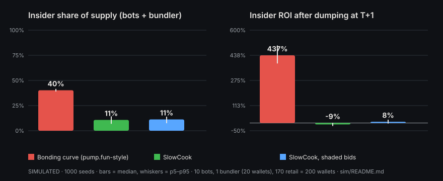

# SlowCook simulator (SIMULATED)

Everything this folder produces is **SIMULATED**: synthetic agents, not market data.

It runs the same 200 wallets through two launch mechanisms and measures who gets the supply and who profits:
- **(A)** a pump.fun-style bonding curve;
- **(B)** SlowCook.

```bash
node src/run.ts --seeds 1000     # writes out/summary.json, out/runs.csv, out/chart.svg (~3 s)
node --test test/*.test.ts       # model + clearing tests
node src/parity.ts --cases 1000  # fixtures for the Rust parity test (contracts/slowcook/src/parity_tests.rs)
```

Requires Node ≥ 24 (it runs `.ts` files directly through type stripping) and has no dependencies.

## Population (per seed)

| Group | Count | Budget | Behaviour |
|---|---|---|---|
| Sniper bots | 10 | U(0.2, 0.5) NEAR each | Buy in block 0 on the curve |
| Bundler | 1 operator, 20 wallets | 10 NEAR total | Buys in the create transaction on the curve |
| Retail | 170 | log-normal, median 0.8 NEAR, σ 0.9, cap 20 | Valuation log-normal, median 2.5e-7 NEAR/token, σ 0.7; random arrival order |

That makes 200 wallets.

## (A) Bonding curve

- Constant product on virtual reserves: 30 NEAR / 1.073B tokens (pump.fun's curve shape), with a 1% fee.
- The bundler buys first, then the bots in random order. Retail then arrive in random order and buy their whole budget if the current price is below their valuation.
- At **T+1**, the bots and then the bundler sell everything back into the curve.
- Retail tokens are valued at the post-dump price.
- Simplification: there is no migration step at graduation. The same curve keeps trading.

## (B) SlowCook

**Supply and pricing**
- Total supply 1B; split 60% sale, 30% LP, 10% creator.
- `p_min` equals the curve's opening price.
- 64 ticks with a 1.15 factor.

**Auction**
- The auction uses `src/clearing.ts`, the bigint mirror of the contract math.
- Parity with the contract is enforced by `parity_tests.rs`: 1,000 cases through the pure math and 100 through the full contract flow.

**Bidding strategies**
- Retail bid their valuation as their limit price. In the shaded variant they bid valuation × (1 − U(0, 0.3)).
- Insiders play the strongest strategy we found:
  - they know the whole retail demand curve;
  - they compute the clearing price retail alone would set;
  - they bid one tick (+15%) above it, so they are always filled in full.
- Bidding higher would not lower their price, and bidding first is meaningless.

**After the auction**
1. The pool opens at the clearing price.
2. Only demand the auction left unfilled may buy, at most the unfilled quantity times the bidder's own limit, and only while spot is below their valuation.
3. Insiders then dump everything at T+1.
4. The Floor Keeper runs one capped defend: at most 10% of the treasury, never above the clearing price.

## Results: 1000 seeds, median (p5–p95)

The table below is copied from `out/summary.json`, generated 2026-11-09.

| Metric | Bonding curve | SlowCook | SlowCook (shaded bids) |
|---|---|---|---|
| Insider share of supply before the dump | 40.3% (39.0–41.6) | 10.7% (6.9–14.3) | 11.2% (7.5–13.9) |
| — bundler share | 32.4% (31.7–33.2) | 8.0% (5.1–10.7) | 8.3% (5.5–10.3) |
| Insider ROI after the T+1 dump | +437% (385–501) | −9.2% (−19.3 to −0.1) | +7.6% (−3.3 to 21.1) |
| Insider PnL (NEAR) | +59.0 | −0.9 | +0.7 |
| Retail aggregate PnL (NEAR) | −37.9 | −7.0 | −2.1 |
| Median retail ROI | −57.6% | −8.3% | −0.7% |
| Price drop caused by the dump | 81.0% | 17.8% | 28.5% |
| Retail average price ÷ insider average price | 4.26× | 1.00× | 1.01× |



## How to read it, honestly

- **What changes.** On the curve, insiders take about 40% of supply at a quarter of retail's price, and their dump takes more than 4× their money out of retail.
  - Under SlowCook, insiders pay **exactly** what retail pays (1.00×), and their share is set by how much money they bring, not by speed.
  - Dumping right after launch then loses money or roughly breaks even.
- **What does not change.**
  - If insiders dump, everyone who holds is still down. In SlowCook, "retail buyers losing money" is 100%, because every buyer paid the same price and then the price dipped.
  - The losses are just much smaller (median −8% vs −58%).
  - SlowCook removes the *first-mover subsidy*. It does not create value.
- **Shaded bids.**
  - When retail shade, more demand is left unfilled and buys in the pool after launch.
  - That lets insiders exit at a small profit (median +7.6%), still about 57× less than on the curve.
- **Calibration.** The curve's bundler share (32%) is close to the 36.5% average bundled-supply share measured across 41k Solana launches (MELT 2026, `research/00-brief.md`). The other parameters are assumptions.
- **Not modelled.**
  - Gas or priority fees.
  - Post-launch speculation beyond unfilled demand.
  - Multiple Floor Keeper epochs.
  - The bonding curve's graduation step.
  - Insiders colluding with the creator.
